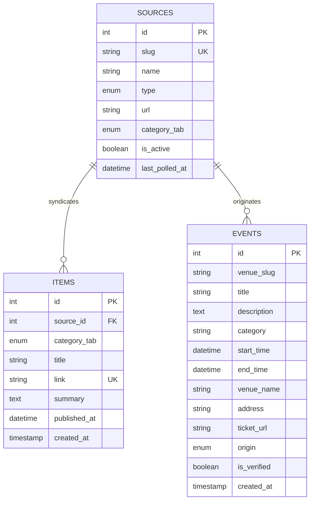

# AgendaWeb Database Schema & Data Dictionary

This document specifies the MariaDB relational database design for AgendaWeb, hosted on Hostinger.

---

## 1. Entity-Relationship Overview

---

## 2. Table Specifications

### 2.1 `sources`
Maintains the registry of all external ingestion targets (RSS feeds and scrape targets).

| Column | Type | Constraints | Description |
| :--- | :--- | :--- | :--- |
| `id` | `INT` | `AUTO_INCREMENT`, `PRIMARY KEY` | Unique source identifier. |
| `slug` | `VARCHAR(60)` | `UNIQUE`, `NOT NULL` | Human-readable identifier (e.g., `abc-news`, `gasometer-hotel`). |
| `name` | `VARCHAR(120)` | `NOT NULL` | Display name of the publisher or venue. |
| `type` | `ENUM` | `'rss', 'scrape_event'` | Ingestion strategy: standard XML feed vs HTML JSON-LD scraping. |
| `url` | `VARCHAR(255)` | `NOT NULL` | Ingestion target endpoint (feed URL or venue gigs page). |
| `category_tab` | `ENUM` | `'events', 'news', 'politics', 'culture'` | Target magazine channel destination. |
| `is_active` | `TINYINT(1)` | `DEFAULT 1` | Soft toggle to pause polling without deletion. |
| `last_polled_at` | `DATETIME` | `NULL` | Timestamp of last successful ingestion check. |

**Indexes:**
- `INDEX (category_tab)`: Fast filtering by channel.
- `INDEX (is_active)`: Quick lookup of enabled sources for cron runners.

---

### 2.2 `events`
Stores parsed and verified cultural listings (music gigs, art exhibitions, screenings).

| Column | Type | Constraints | Description |
| :--- | :--- | :--- | :--- |
| `id` | `INT` | `AUTO_INCREMENT`, `PRIMARY KEY` | Event ID used for permalinks and `.ics` generation. |
| `venue_slug` | `VARCHAR(60)` | `NOT NULL` | Maps event to venue identity or subdomain. |
| `title` | `VARCHAR(255)` | `NOT NULL` | Title of the event or performance. |
| `description` | `TEXT` | `NULL` | Sanitized text summary of the event. |
| `category` | `VARCHAR(60)` | `DEFAULT 'Culture'` | Genre/type (e.g., `Live Music`, `Art`, `Comedy`, `Festival`). |
| `start_time` | `DATETIME` | `NOT NULL` | Scheduled start date and time. |
| `end_time` | `DATETIME` | `NULL` | Optional end time (defaults to `+2 hours` if null). |
| `venue_name` | `VARCHAR(150)` | `NOT NULL` | Canonical venue or space name. |
| `address` | `VARCHAR(255)` | `NULL` | Physical address for geocoding and map orientation. |
| `ticket_url` | `VARCHAR(255)` | `NULL` | Deep-link directly to venue or ticketing partner checkout. |
| `origin` | `ENUM` | `'scraped', 'manual'` | Source provenance (`manual` prevents scraper overwrites). |
| `is_verified` | `TINYINT(1)` | `DEFAULT 0` | Trust badge indicator (1 = verified venue/organizer). |
| `created_at` | `TIMESTAMP` | `DEFAULT CURRENT_TIMESTAMP` | Record creation time. |

**Deduplication Constraint:**
- `UNIQUE KEY idx_venue_event_time (venue_slug, title(100), start_time)`: Prevents duplicate entries on repeated scraper runs while enabling safe `ON DUPLICATE KEY UPDATE`.

---

### 2.3 `items`
Stores news, commentary, and editorial dispatches from syndicated public media sources.

| Column | Type | Constraints | Description |
| :--- | :--- | :--- | :--- |
| `id` | `INT` | `AUTO_INCREMENT`, `PRIMARY KEY` | Unique item identifier. |
| `source_id` | `INT` | `FOREIGN KEY (sources.id)` | Source publisher reference (`ON DELETE CASCADE`). |
| `category_tab` | `ENUM` | `'news', 'politics', 'culture'` | Magazine tab placement. |
| `title` | `VARCHAR(255)` | `NOT NULL` | Article headline. |
| `link` | `VARCHAR(255)` | `UNIQUE`, `NOT NULL` | Canonical article link (also acts as natural unique key). |
| `summary` | `TEXT` | `NULL` | Short summary / snippet (capped at 300 characters). |
| `published_at` | `DATETIME` | `NOT NULL` | Original publication date. |
| `created_at` | `TIMESTAMP` | `DEFAULT CURRENT_TIMESTAMP` | Ingestion timestamp. |

**Indexes:**
- `INDEX (published_at)`: Reverse chronological sorting for news feeds.
- `INDEX (category_tab)`: Fast category tab queries.
