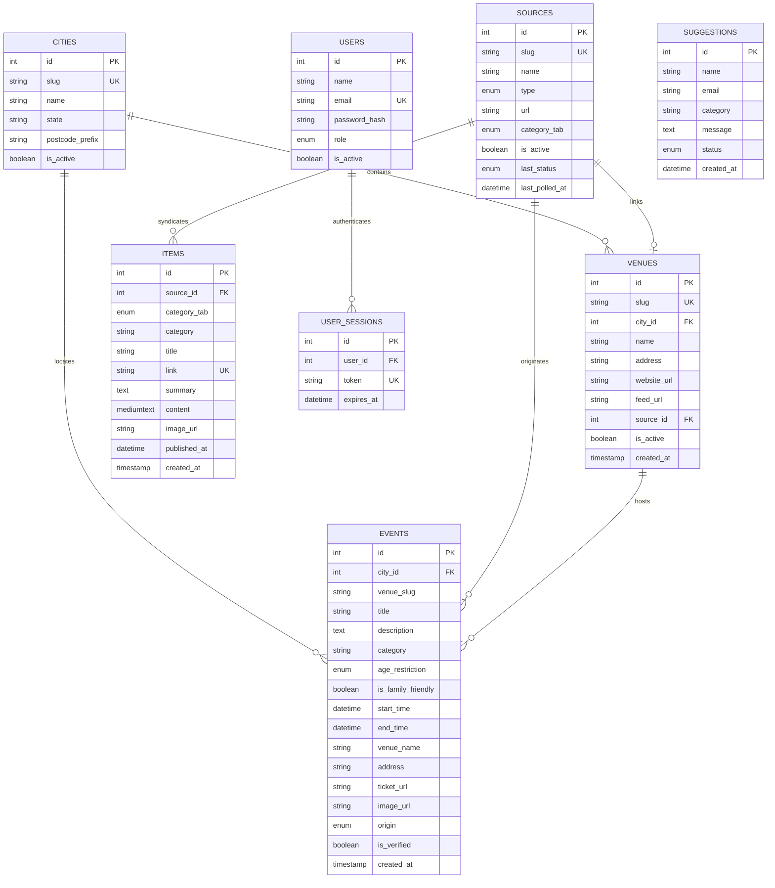

# AgendaWeb Database Schema & Data Dictionary

This document specifies the Hostinger MySQL (8.x) relational database design for AgendaWeb, along with the development server's file-backed local persistence layer.

---

## 1. Entity-Relationship Overview

---

## 2. Table Specifications

### 2.1 `cities`
Maintains Australian cultural hub metropolitan areas and states for multi-city feed filtering and automated postal code mapping.

| Column | Type | Constraints | Description |
| :--- | :--- | :--- | :--- |
| `id` | `INT` | `AUTO_INCREMENT`, `PRIMARY KEY` | Unique city identifier. |
| `slug` | `VARCHAR(50)` | `UNIQUE`, `NOT NULL` | URL-safe slug (e.g. `melbourne`, `sydney`, `brisbane`). |
| `name` | `VARCHAR(100)` | `NOT NULL` | Display name (e.g. `Melbourne`, `Sydney`). |
| `state` | `VARCHAR(10)` | `NOT NULL` | Australian State/Territory code (e.g. `VIC`, `NSW`, `QLD`). |
| `country` | `VARCHAR(10)` | `DEFAULT 'AU'` | ISO Country Code. |
| `postcode_prefix`| `VARCHAR(20)` | `NOT NULL` | Postcode prefix digit for automated city classification (e.g. `3` for VIC). |
| `latitude` | `DECIMAL(10, 7)` | `NULL` | City center geographic coordinate for client distance calculations. |
| `longitude`| `DECIMAL(10, 7)` | `NULL` | City center geographic coordinate. |
| `is_active` | `TINYINT(1)` | `DEFAULT 1` | Active city state. |
| `created_at` | `TIMESTAMP` | `DEFAULT CURRENT_TIMESTAMP` | Record creation timestamp. |

**Indexes:**
- `INDEX (slug)`: Fast slug-based city routing.
- `INDEX (is_active)`: City selector filtering.

---

### 2.2 `sources`
Maintains the registry of all external ingestion targets (RSS feeds, WordPress REST endpoints, and scrape targets).

> **Clean-Slate Principle:** The database starts with zero feed seeds. Curators add feeds manually via `/admin/index.html` or review venue submissions from `/venues/index.html`.

| Column | Type | Constraints | Description |
| :--- | :--- | :--- | :--- |
| `id` | `INT` | `AUTO_INCREMENT`, `PRIMARY KEY` | Unique source identifier. |
| `slug` | `VARCHAR(60)` | `UNIQUE`, `NOT NULL` | Human-readable identifier (e.g., `the-tote`, `trouble-mag`, `bar-oussou`). |
| `name` | `VARCHAR(120)` | `NOT NULL` | Display name of the publisher or venue. |
| `type` | `ENUM` | `'rss', 'scrape_event'` | Ingestion strategy: standard XML feed vs HTML JSON-LD scraping. |
| `url` | `VARCHAR(255)` | `NOT NULL` | Ingestion target endpoint (feed URL or venue gigs page). |
| `category_tab` | `ENUM` | `'events', 'news', 'politics', 'culture', 'blogs'` | Target magazine channel destination. |
| `is_active` | `TINYINT(1)` | `DEFAULT 1` | Soft toggle to pause polling without deletion. |
| `last_polled_at` | `DATETIME` | `NULL` | Timestamp of last ingestion check. |
| `last_status` | `ENUM` | `'active', 'updated', 'failed', 'stale', 'pending'` | Real-time scraper health state. `pending` indicates an unapproved venue submission. |
| `http_code` | `SMALLINT` | `NULL` | Last HTTP response code from target site (e.g. 200, 404). |
| `last_error` | `VARCHAR(255)` | `NULL` | Diagnostic error message if ingestion failed. |
| `item_count` | `INT` | `DEFAULT 0` | Total events or articles extracted during last poll. |
| `contact_email` | `VARCHAR(150)` | `NULL` | Organizer contact email submitted via onboarding portal. |
| `submission_notes` | `VARCHAR(255)` | `NULL` | Internal curator or moderation notes. |

**Indexes:**
- `INDEX (category_tab)`: Fast filtering by channel.
- `INDEX (is_active)`: Quick lookup of enabled sources for cron runners.
- `INDEX (last_status)`: Scraper health monitoring and failing feed alerts.

---

### 2.3 `venues`
Stores physical and cultural venues with their addresses, official websites, and syndication/feed links.

| Column | Type | Constraints | Description |
| :--- | :--- | :--- | :--- |
| `id` | `INT` | `AUTO_INCREMENT`, `PRIMARY KEY` | Unique venue identifier. |
| `slug` | `VARCHAR(60)` | `UNIQUE`, `NOT NULL` | URL-safe slug identifying the venue (e.g. `the-gasometer-hotel`). |
| `city_id` | `INT` | `NULL`, `FK (cities.id)` | Associated city reference (`ON DELETE SET NULL`). |
| `name` | `VARCHAR(150)` | `NOT NULL` | Full display name of the venue or organizer. |
| `address` | `VARCHAR(255)` | `NULL` | Street address and postcode (e.g. `484 Smith St, Collingwood VIC 3066`). |
| `suburb` | `VARCHAR(100)` | `NULL` | Neighborhood/suburb for hyper-local filtering. |
| `state` | `VARCHAR(10)` | `DEFAULT 'VIC'` | Australian state. |
| `postcode` | `VARCHAR(10)` | `NULL` | Postal code for spatial proximity. |
| `latitude` | `DECIMAL(10, 7)` | `NULL` | Latitude for client distance calculation. |
| `longitude`| `DECIMAL(10, 7)` | `NULL` | Longitude for client distance calculation. |
| `website_url` | `VARCHAR(255)` | `NULL` | Official website or gig guide page URL. |
| `feed_url` | `VARCHAR(255)` | `NULL` | RSS/Atom or iCal feed URL if provided by the venue. |
| `default_age_policy` | `ENUM` | `'18+', 'all_ages', 'mixed', 'family'` | Default venue entry age policy. |
| `source_id` | `INT` | `NULL`, `FK` | Linked source ID in `sources` table. |
| `is_active` | `TINYINT(1)` | `DEFAULT 1` | Active venue status. |
| `created_at` | `TIMESTAMP` | `DEFAULT CURRENT_TIMESTAMP` | Venue registration timestamp. |

**Indexes:**
- `INDEX (name)`: Venue search and alphabetical ordering.
- `INDEX (slug)`: Fast foreign key and slug lookup.
- `INDEX (city_id)`: Multi-city venue filtering.
- `INDEX (suburb)`: Neighborhood aggregation.

---

### 2.4 `events`
Stores parsed and verified cultural listings (music gigs, art exhibitions, screenings, family activities).

| Column | Type | Constraints | Description |
| :--- | :--- | :--- | :--- |
| `id` | `INT` | `AUTO_INCREMENT`, `PRIMARY KEY` | Event ID used for permalinks and `.ics` generation. |
| `city_id` | `INT` | `NULL`, `FK (cities.id)` | Associated city reference (`ON DELETE SET NULL`). |
| `venue_slug` | `VARCHAR(60)` | `NOT NULL` | Maps event to venue identity or subdomain. |
| `title` | `VARCHAR(255)` | `NOT NULL` | Title of the event or performance. |
| `description` | `TEXT` | `NULL` | Sanitized text summary of the event. |
| `category` | `VARCHAR(60)` | `DEFAULT 'Culture'` | Genre/type (e.g., `Live Music`, `Art`, `Comedy`, `Festival`). Auto-grouped for subcategory filtering. |
| `age_restriction` | `ENUM` | `'18+', 'all_ages', '15+', 'kids_family', 'unrated'` | Age restriction classification for audience filtering. |
| `min_age` | `TINYINT UNSIGNED` | `NULL` | Explicit minimum age limit (e.g. 18, 15, 0). |
| `is_family_friendly` | `TINYINT(1)` | `DEFAULT 0` | Flag for children's theatre, puppet shows, and daytime matinees. |
| `start_time` | `DATETIME` | `NOT NULL` | Scheduled start date and time. |
| `end_time` | `DATETIME` | `NULL` | Optional end time (defaults to `+2 hours` if null). |
| `venue_name` | `VARCHAR(150)` | `NOT NULL` | Canonical venue or space name. |
| `address` | `VARCHAR(255)` | `NULL` | Physical address for geocoding and map orientation. |
| `suburb` | `VARCHAR(100)` | `NULL` | Suburb location. |
| `ticket_url` | `VARCHAR(255)` | `NULL` | Deep-link directly to venue or ticketing partner checkout. |
| `image_url` | `VARCHAR(500)` | `NULL` | Promotional banner / poster image URL for card rendering. |
| `origin` | `ENUM` | `'scraped', 'manual'` | Source provenance (`manual` prevents scraper overwrites). |
| `is_verified` | `TINYINT(1)` | `DEFAULT 0` | Trust badge indicator (1 = verified venue/organizer). |
| `created_at` | `TIMESTAMP` | `DEFAULT CURRENT_TIMESTAMP` | Record creation time. |

**Indexes & Deduplication:**
- `UNIQUE KEY idx_venue_event_time (venue_slug, title(100), start_time)`: Prevents duplicate entries on repeated scraper runs while enabling safe `ON DUPLICATE KEY UPDATE`.
- `INDEX (city_id, start_time)`: High-performance composite index for chronological multi-city feed loading.
- `INDEX (age_restriction)`: Rapid filtering for 18+ vs Family feeds.
- `INDEX (is_family_friendly)`: One-tap family mode activation.

---

### 2.5 `items`
Stores news, commentary, and editorial dispatches from syndicated public media sources and independent cultural blogs.

| Column | Type | Constraints | Description |
| :--- | :--- | :--- | :--- |
| `id` | `INT` | `AUTO_INCREMENT`, `PRIMARY KEY` | Unique item identifier. |
| `source_id` | `INT` | `FOREIGN KEY (sources.id)` | Source publisher reference (`ON DELETE CASCADE`). |
| `category_tab` | `ENUM` | `'news', 'politics', 'culture', 'blogs'` | Magazine tab placement. |
| `category` | `VARCHAR(60)` | `DEFAULT 'General'` | Subcategory extracted automatically from feed tags (`<category>`) or topic. |
| `title` | `VARCHAR(255)` | `NOT NULL` | Article headline. |
| `link` | `VARCHAR(255)` | `UNIQUE`, `NOT NULL` | Canonical article link (also acts as natural unique key). |
| `summary` | `TEXT` | `NULL` | Short summary / snippet (capped at 300 characters). |
| `content` | `MEDIUMTEXT` | `NULL` | Full-text article content / HTML extracted from `<content:encoded>` or `<content>`. |
| `image_url` | `VARCHAR(500)` | `NULL` | Hero preview image extracted from feed enclosure or `<media:content>`. |
| `published_at` | `DATETIME` | `NOT NULL` | Original publication date. |
| `created_at` | `TIMESTAMP` | `DEFAULT CURRENT_TIMESTAMP` | Ingestion timestamp. |

**Indexes:**
- `INDEX (published_at)`: Reverse chronological sorting for news feeds.
- `INDEX (category_tab)`: Fast category tab queries.
- `INDEX (category)`: Dynamic subcategory grouping and filtering.

---

### 2.6 `suggestions`
Stores reader suggestions, feedback, and venue recommendations submitted via the Help modal.

| Column | Type | Constraints | Description |
| :--- | :--- | :--- | :--- |
| `id` | `INT` | `AUTO_INCREMENT`, `PRIMARY KEY` | Suggestion identifier. |
| `name` | `VARCHAR(150)` | `NULL` | Sender name (optional). |
| `email` | `VARCHAR(150)` | `NULL` | Sender email (optional). |
| `category` | `VARCHAR(60)` | `NOT NULL DEFAULT 'general'` | Feedback category (`feature`, `venue_feed`, `bug`, `feedback`). |
| `message` | `TEXT` | `NOT NULL` | Suggestion text content. |
| `status` | `ENUM` | `'new', 'read', 'archived'` | Admin management status. |
| `created_at` | `DATETIME` | `DEFAULT CURRENT_TIMESTAMP` | Submission timestamp. |

**Indexes:**
- `INDEX (status)`: Fast filtering in Admin Suggestion Inbox.
- `INDEX (created_at)`: Reverse chronological sorting.

---

### 2.7 `users`
Stores authenticated users and managers for the Admin and Curator Portal with role-based access control (RBAC).

| Column | Type | Constraints | Description |
| :--- | :--- | :--- | :--- |
| `id` | `INT` | `AUTO_INCREMENT`, `PRIMARY KEY` | User identifier. |
| `name` | `VARCHAR(120)` | `NOT NULL` | Display name of the team member. |
| `email` | `VARCHAR(150)` | `UNIQUE`, `NOT NULL` | Unique login email address. |
| `password_hash` | `VARCHAR(255)` | `NOT NULL` | Bcrypt/Argon2 password hash. |
| `role` | `ENUM` | `'admin', 'manager'` (default `'manager'`) | Access level (`admin`: full team, cron & system control; `manager`: curation & dispatches). |
| `is_active` | `TINYINT(1)` | `DEFAULT 1` | Active account toggle (0 blocks login and revokes active sessions). |
| `last_login_at` | `DATETIME` | `NULL` | Timestamp of last successful login. |
| `created_at` | `TIMESTAMP` | `DEFAULT CURRENT_TIMESTAMP` | Account creation timestamp. |
| `updated_at` | `TIMESTAMP` | `ON UPDATE CURRENT_TIMESTAMP` | Last profile/password change timestamp. |

**Indexes:**
- `INDEX (email)`: Fast login lookup.
- `INDEX (role)`: Role-based filtering.
- `INDEX (is_active)`: Status checks.

---

### 2.8 `user_sessions`
Stores active authentication tokens (Bearer tokens) issued upon email/password verification.

| Column | Type | Constraints | Description |
| :--- | :--- | :--- | :--- |
| `id` | `INT` | `AUTO_INCREMENT`, `PRIMARY KEY` | Session record identifier. |
| `user_id` | `INT` | `NOT NULL`, `FK (users.id)` | User reference (`ON DELETE CASCADE`). |
| `token` | `VARCHAR(64)` | `UNIQUE`, `NOT NULL` | Cryptographically secure 64-character session token. |
| `ip_address` | `VARCHAR(45)` | `NULL` | Client IP address at login. |
| `user_agent` | `VARCHAR(255)` | `NULL` | User agent string for session audit. |
| `expires_at` | `DATETIME` | `NOT NULL` | Session expiry timestamp (standard 30 days rolling). |
| `created_at` | `TIMESTAMP` | `DEFAULT CURRENT_TIMESTAMP` | Session start timestamp. |

**Indexes:**
- `INDEX (token)`: O(1) Bearer token lookup for API authentication.
- `INDEX (expires_at)`: Fast session expiration cleanup.

---

## 3. Dual Persistence Architecture & Dev Storage

AgendaWeb employs a dual persistence model:
1. **Production (Hostinger MySQL 8.x):** Uses relational tables defined in `Docs/Schema.sql` with full foreign keys, cascading deletions, and ACID transactions.
2. **Local Development Server (`Application/dev_server.js`):** Uses an asynchronous, file-backed JSON database located in `Application/data/`:
   - `sources.json`: External feed and scraper registry.
   - `venues.json`: Venue profiles and subdomains.
   - `events.json`: Gigs and cultural listings.
   - `items.json`: Syndicated articles and dispatches.
   - `tombstones.json`: Blacklist of deleted item links, event keys, and source URLs.

### Tombstone Architecture
When an administrator deletes an event, article, or feed from the feed manager:
- The record is purged from active tables (`events`, `items`, `sources`).
- A cryptographic signature or canonical key (`link` or `venue_slug:title:start_time`) is recorded into the tombstone registry.
- Subsequent scraper cycles check incoming entries against the tombstone store, guaranteeing deleted items are never accidentally resurrected.
