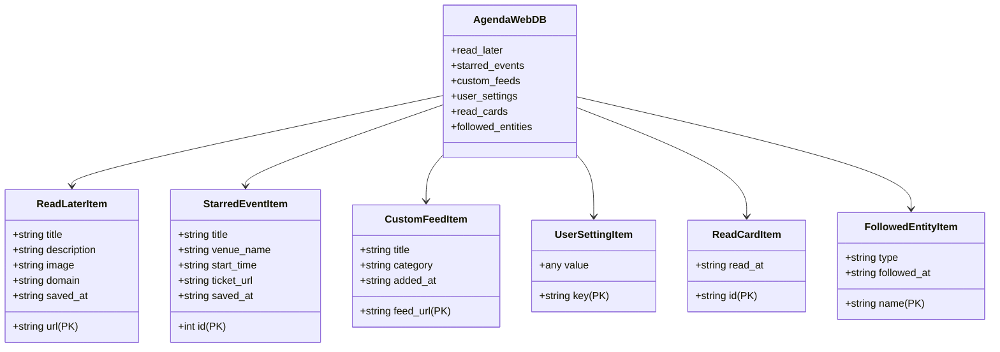

# AgendaWeb Frontend & IndexedDB Specification

This document details the local-first client architecture for the AgendaWeb Progressive Web App (PWA).

---

## 1. Local-First Philosophy

In alignment with Directive #1 (*Zero Consumer Authentication*):
- No user accounts or personal profiles exist on the AgendaWeb server.
- The client browser acts as the primary sovereign database for all user actions:
  - Saved articles & links ("Read Later")
  - Starred gigs & calendar reminders
  - Custom user-added RSS feed subscriptions
  - Reader preferences ("Clean Mode" toggle, custom tab ordering)

---

## 2. IndexedDB Database Design

- **Database Name:** `AgendaWebDB`
- **Current Version:** `2`

---

## 3. Object Store Schemas

### 3.1 `read_later`
Stores web links extracted via `/api/extract.php` or saved directly from the News/Culture tabs.

| Key | Type | Description |
| :--- | :--- | :--- |
| `url` *(KeyPath)* | `string` | Canonical link URL (unique identifier). |
| `title` | `string` | Article title. |
| `description` | `string` | Short snippet / excerpt. |
| `image` | `string` | OpenGraph hero image preview URL. |
| `domain` | `string` | Source site domain (e.g., `theconversation.com`). |
| `saved_at` | `string` | ISO 8601 timestamp (`2026-10-18T10:00:00Z`). |

**Indexes:**
- `idx_saved_at (saved_at)`: Reverse chronological sorting for the "Reads" tab.

---

### 3.2 `starred_events`
Stores user-bookmarked gigs and cultural events for offline reference and calendar tracking.

| Key | Type | Description |
| :--- | :--- | :--- |
| `id` *(KeyPath)* | `number` | Server event ID. |
| `title` | `string` | Gig or event title. |
| `venue_name` | `string` | Venue name. |
| `start_time` | `string` | Event start timestamp. |
| `ticket_url` | `string` | Direct ticketing URL. |
| `saved_at` | `string` | ISO 8601 timestamp. |

**Indexes:**
- `idx_start_time (start_time)`: Chronological sorting (upcoming first).

---

### 3.3 `custom_feeds`
Enables users to syndicate private or community RSS feeds into their broadsheet reader.

| Key | Type | Description |
| :--- | :--- | :--- |
| `feed_url` *(KeyPath)* | `string` | Public RSS/Atom URL. |
| `title` | `string` | Custom user or feed title. |
| `category` | `string` | Target category tab. |
| `added_at` | `string` | ISO 8601 timestamp. |

---

### 3.4 `user_settings`
Key-value store preserving user interface preferences across browser sessions.

| Key *(KeyPath)* | Default Value | Description |
| :--- | :--- | :--- |
| `clean_mode` | `false` | When `true`, disables news/politics tabs; runs as dedicated event gig guide. |
| `active_tab` | `'events'` | Last selected top-level tab. |
| `event_filter` | `'All'` | Last selected event category pill. |

---

### 3.5 `read_cards`
Tracks read/checked status for events, news, blogs, and custom feeds to power the circular checkmark indicator.

| Key | Type | Description |
| :--- | :--- | :--- |
| `id` *(KeyPath)* | `string` | Event ID, article link, or feed item identifier. |
| `read_at` | `string` | ISO 8601 timestamp when marked as read/checked. |

---

### 3.6 `followed_entities`
Stores venues, artists, and independent organisers that the user follows via the RSS button on event cards.

| Key | Type | Description |
| :--- | :--- | :--- |
| `name` *(KeyPath)* | `string` | Venue, artist, or organiser name (e.g., `The Gasometer Hotel`). |
| `type` | `string` | Entity type (`venue`, `artist`, `organiser`). |
| `followed_at` | `string` | ISO 8601 timestamp when followed. |

**Indexes:**
- `idx_type (type)`: Filter by entity type.

---

## 4. OPML & JSON Data Portability

Users own their data. Under the Settings drawer:
1. **Export OPML:** Exports all subscribed feeds (`custom_feeds`) into standard OPML format for NetNewsWire, Feedly, or Readwise.
2. **Export JSON:** Dumps all `starred_events`, `read_later` items, `custom_feeds`, `read_cards`, and `followed_entities` into a single portable backup file.
3. **Import JSON:** 1-click restore across multiple devices with zero server accounts.
4. **Clear Local Data:** One-click wipe of `AgendaWebDB` with zero leftover footprints.

---

## 5. Client Interaction Workflows

### 5.1 Circular Check Mark Indicator
- **Unread/Unopened:** Displays an unfilled outline circle with a subtle checkmark `○`.
- **Read/Checked:** Displays a solid green circular badge with a bright white checkmark `✓` (`.is-read`).
- **Auto-Check Trigger:** Opening the card link, clicking "Read Full ↗", "Read Article ↗", "Tickets", or "Add to Calendar" automatically marks the item as read in IndexedDB and updates the check icon.
- **Manual Toggle:** Clicking the check circle directly toggles read/unread status on demand.

### 5.2 Following Channel & RSS Follow Button
- **Bottom-Right Follow Button:** Every gig card features a dedicated follow button with the open RSS icon: `<button class="btn btn-follow"><svg class="rss-icon">...</svg> Follow</button>`.
- **Toggle State:** Following switches the button to an active state (`Following ✓`) and persists the venue in `followed_entities`.
- **📡 Following Channel:** A top-level tab displaying only upcoming events from followed venues/artists.
- **Dynamic Category Filtering:** Auto-extracts subcategories specifically for followed events (e.g. *Live Music*, *Art*).
- **Followed Chips Bar:** The Following feed features top chips showing followed venues with one-tap removal (`✕`).
